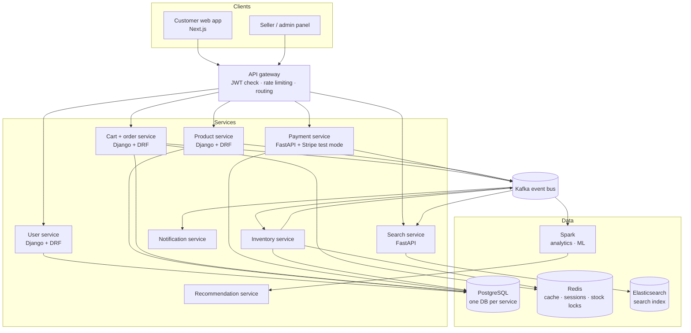
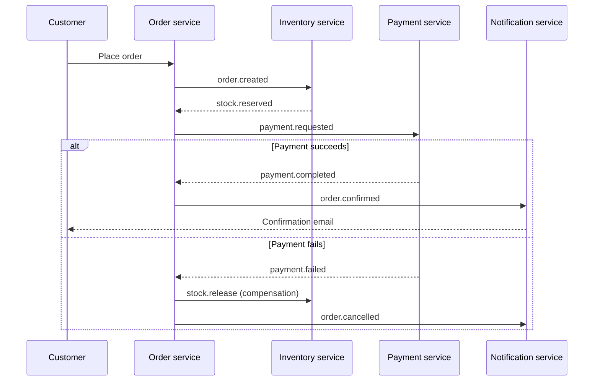

# Shopverse

A multi-seller e-commerce marketplace built with a microservices architecture, inspired by large-scale platforms like Flipkart and Amazon.

The goal of this project is to solve the real engineering problems behind a large online store: preventing overselling during flash sales, keeping orders consistent across services, fast product search, and turning user activity into recommendations with big-data tools.

> **Status:** In active development. See the [roadmap](#roadmap) for what is built and what is next.

---

## Table of contents

- [Architecture](#architecture)
- [Tech stack](#tech-stack)
- [Services](#services)
- [Features](#features)
- [Key engineering problems](#key-engineering-problems)
- [Security](#security)
- [Event flow](#event-flow)
- [Repository structure](#repository-structure)
- [Getting started](#getting-started)
- [Testing](#testing)
- [Roadmap](#roadmap)
- [Author](#author)

---

## Architecture



**Design principles**

- **Database per service:** each service owns its data; services never read each other's tables.
- **Event-driven:** services communicate asynchronously through Kafka events, so one slow or failing service does not take down the others.
- **Stateless services:** all state lives in databases and Redis, so any service can be scaled horizontally.
- **Monolith first:** the project started as a modular Django monolith and was split into services where boundaries were clear. See [`docs/design-decisions.md`](docs/design-decisions.md).

---

## Tech stack

| Layer | Technology |
|---|---|
| Frontend | Next.js, React |
| Admin panel | React / Vue |
| Backend services | Django, Django REST Framework, FastAPI |
| API gateway | Nginx |
| Messaging | Apache Kafka |
| Databases | PostgreSQL |
| Cache and locks | Redis |
| Search | Elasticsearch |
| Big data and ML | Apache Spark (Spark SQL, MLlib) |
| Payments | Stripe (test mode only) |
| Containers | Docker, Docker Compose |
| Orchestration | Kubernetes (local cluster via kind) |
| CI | GitHub Actions |
| Load testing | k6 |

---

## Services

| Service | Responsibility | Stack |
|---|---|---|
| `users` | Registration, login, JWT tokens, profiles, addresses, roles | Django + DRF |
| `products` | Catalogue, categories, variants, images, seller listings | Django + DRF |
| `orders` | Cart, checkout, order lifecycle, saga orchestration | Django + DRF |
| `payments` | Payment intents, Stripe webhooks, refunds | FastAPI |
| `search` | Full-text search, filters, autosuggest | FastAPI + Elasticsearch |
| `inventory` | Stock levels, reservations, flash-sale protection | Django + Redis |
| `notifications` | Order and payment emails, consuming Kafka events | Python Kafka consumer |
| `analytics` | Recommendations and seller sales reports | Spark |

---

## Features

**Customers**
- Sign up, log in, manage profile and saved addresses
- Browse categories, search with filters, sort and pagination
- Product pages with variants (size, colour), ratings and reviews
- Cart, wishlist, checkout and test-mode payments
- Order history and order status tracking
- "Customers also bought" recommendations

**Sellers**
- Seller accounts on a shared marketplace
- Add and manage products and stock
- Sales analytics dashboard

**Admins**
- Manage users, sellers, products and orders
- Create coupons and flash sales
- Audit log of admin actions

---

## Key engineering problems

### 1. Preventing overselling
When many users try to buy the last few units at once, stock must never go below zero. Stock is **reserved** atomically in Redis at checkout and the reservation expires if payment is not completed, returning the units to stock.

### 2. Consistent orders across services (Saga pattern)
Placing an order touches inventory, payment and notifications, each with its own database. Instead of a distributed transaction, the order service runs a **saga**: each step publishes an event, and if a step fails (e.g. payment declined), compensating actions undo the earlier steps (e.g. release reserved stock).

### 3. Fast search
PostgreSQL is the source of truth; Elasticsearch holds a search-optimised copy. Product changes publish Kafka events that keep the index in sync.

### 4. Performance under load
Hot data (product pages, categories) is cached in Redis, images are served from object storage, and all list endpoints are paginated. Results are measured with k6 load tests in [`load-tests/`](load-tests/).

---

## Security

- **Passwords:** hashed with Argon2 / bcrypt, never stored in plain text
- **Authentication:** short-lived JWT access tokens and rotating refresh tokens in httpOnly cookies
- **Authorisation:** role-based access (customer, seller, admin) plus ownership checks on every resource, so a user can only access their own orders and addresses
- **OWASP Top 10:** ORM-only queries (SQL injection), input validation with DRF serializers and Pydantic, output escaping and Content Security Policy headers (XSS), CSRF protection
- **Payments:** card details never touch this system; Stripe handles them, webhook signatures are verified, and idempotency keys prevent double charges
- **Rate limiting:** at the gateway, to slow down brute-force logins and scraping
- **Secrets:** loaded from environment variables, never committed (see `.env.example`)
- **Audit logging:** all admin actions are recorded

---

## Event flow

Example: a customer places an order.



---

## Repository structure

```
.
├── README.md
├── docker-compose.yml       # runs the full platform locally
├── .env.example             # environment variables template
├── .github/workflows/       # CI pipelines
├── frontend/                # Next.js customer storefront
├── admin/                   # seller and admin panel
├── gateway/                 # API gateway configuration
├── services/
│   ├── users/
│   ├── products/
│   ├── orders/
│   ├── payments/
│   ├── search/
│   ├── inventory/
│   └── notifications/
├── analytics/               # Spark jobs
├── k8s/                     # Kubernetes manifests
├── load-tests/              # k6 scripts and results
└── docs/                    # API docs and design decisions
```

---

## Getting started

> Setup instructions will be completed as the services are built.

**Prerequisites:** Docker and Docker Compose.

```bash
git clone <repository-url>
cd <repository-folder>
cp .env.example .env
docker compose up --build
```

---

## Testing

Each service has its own test suite, run automatically in CI on every pull request.

```bash
docker compose run --rm users pytest
```

---

## Roadmap

**Phase 1: Core platform**
- [ ] Monorepo scaffold and Docker Compose (PostgreSQL, Redis)
- [ ] User service: signup, login, JWT, profiles, addresses
- [ ] Product service: catalogue, categories, variants
- [ ] Cart and orders
- [ ] Payments with Stripe test mode
- [ ] Customer storefront (Next.js)
- [ ] Admin panel

**Phase 2: Scale and marketplace**
- [ ] API gateway with rate limiting
- [ ] Kafka event bus and saga orchestration
- [ ] Inventory service with stock reservation
- [ ] Elasticsearch search service
- [ ] Seller accounts, coupons, flash sales, reviews
- [ ] Notification service

**Phase 3: Big data and deployment**
- [ ] Clickstream pipeline into Spark
- [ ] Recommendations and seller analytics
- [ ] Kubernetes manifests
- [ ] k6 load tests with published results
- [ ] CI with GitHub Actions

---

## Author

**Vishantkumar Bhavsar**
MSc Big Data Technologies, University of East London
