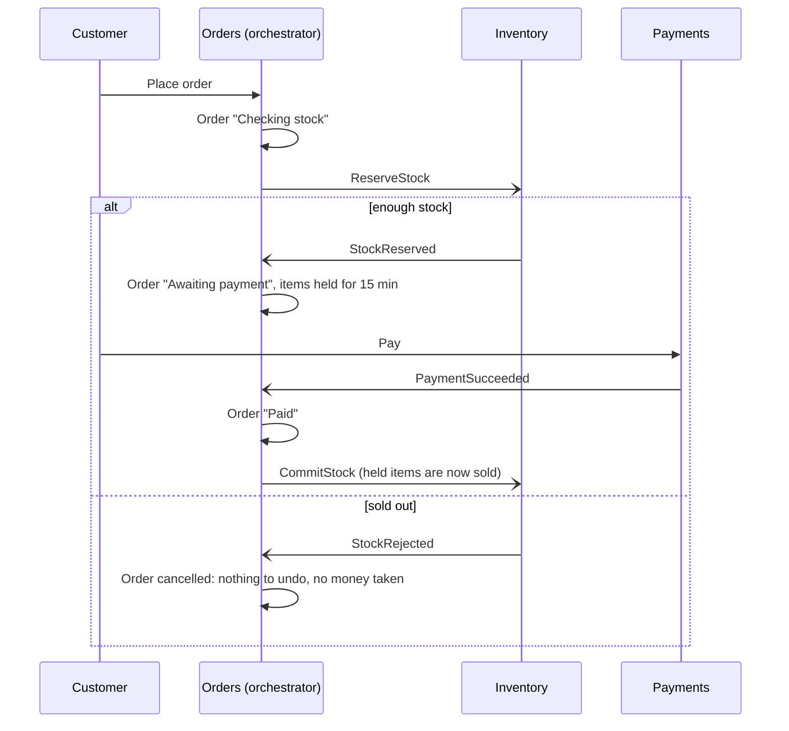

# Events and the checkout saga

Services talk to each other through Kafka for anything that changes state in more than one service. Direct HTTP calls remain only for reads that need an answer straight away. For example, payments asks orders for an order's total before taking a payment.

## Message format

Every message is a JSON object with the same envelope:

```json
{
  "id": "5f0c1c5e-0d6f-4c39-9a51-2b8f5b0a8e41",
  "type": "ReserveStock",
  "source": "orders",
  "occurred_at": "2026-11-12T10:21:07.412Z",
  "key": "SV-20261112-K7Q2ZP",
  "data": { "order_number": "SV-20261112-K7Q2ZP", "lines": [{ "variant_id": "…", "quantity": 2 }] }
}
```

- **`id`** is unique per message. Consumers record every id they've handled, so a message delivered twice is handled once.
- **`key`** is also the Kafka message key. All messages about one order use the order number, so they land on the same partition and are read in the order they were sent. Catalogue messages use the variant id.

## Topics

| Topic | Written by | Read by | Messages |
|---|---|---|---|
| `catalog.variants` | products | inventory | `VariantUpserted`, `VariantRemoved` |
| `inventory.commands` | orders | inventory | `ReserveStock`, `ReleaseStock`, `CommitStock` |
| `inventory.events` | inventory | orders | `StockReserved`, `StockRejected`, `StockReleased`, `StockCommitted` |
| `payments.commands` | orders | payments | `RefundPayment` |
| `payments.events` | payments | orders | `PaymentSucceeded`, `PaymentFailed`, `PaymentRefunded`, `RefundFailed` |
| `orders.events` | orders | (future: notifications, analytics) | `OrderPlaced`, `OrderConfirmed`, `OrderCancelled` |

Every topic has a dead-letter twin (`<topic>.dlq`). A message that still fails after 3 attempts is moved there with the error attached, so one bad message can't block everything behind it.

## How a message gets out: the transactional outbox

A service never writes to its database and then sends to Kafka as two separate steps. If it crashed between them, the database and the rest of the system would disagree. Instead, the message is written to an `outbox` table **in the same database transaction** as the change it describes. A relay in the service's worker reads unsent rows, publishes them, and marks them sent.

- If the transaction rolls back, no message exists.
- If the relay crashes after publishing but before marking a row sent, that message goes out twice. Consumers drop the duplicate by its id.

## How a message is handled: idempotent consumers

Each worker reads with automatic offset commits switched off. For every message it:

1. records the message id in `processed_messages` (a repeat stops here),
2. runs the handler,
3. writes any reply to its own outbox,

all in one database transaction. Only after that commit does it commit the Kafka offset. A crash at any point means the message is read again and either handled in full or recognised as already done.

If the database is unreachable, the worker waits and retries the same message without skipping it. Any other error is retried 3 times and then sent to the dead-letter topic.

## The checkout saga

Placing an order touches three services, each with its own database, so there's no single transaction that can cover them. The orders service runs the checkout as a **saga**: a series of local steps, each with an undo step (a *compensation*) if a later step fails. Orders is the **orchestrator**. It keeps the saga's state next to the order, sends commands, reacts to the replies, and decides what to undo.



### What gets undone, and when

| What happens | Order becomes | Compensation sent |
|---|---|---|
| Stock can't be reserved | Cancelled ("sold out") | None (nothing was held or charged) |
| No answer from inventory within 2 minutes | Cancelled | `ReleaseStock`, in case the reservation lands later |
| Not paid within the hold time (15 minutes) | Cancelled | `ReleaseStock` |
| Customer or admin cancels before payment | Cancelled | `ReleaseStock` |
| Customer or admin cancels after payment | Cancelled | `ReleaseStock` (back on sale) and `RefundPayment` |
| Payment arrives after the order was cancelled | Stays cancelled | `RefundPayment` |
| Payment amount doesn't match the order | Stays awaiting payment | `RefundPayment`; the customer can pay again |

Timeouts are checked by the orders worker every few seconds. Every step locks the order row, so a payment arriving at the same moment the hold expires is handled one way or the other, never both. If the timeout wins, the late payment is refunded.

### Why stock is held, then committed

A reservation (`reserved += n`) takes items off sale without changing what's on the shelf. Only when the order is paid does `CommitStock` turn the hold into a sale (`on_hand -= n`, `reserved -= n`). Releasing a hold just gives the items back. Releasing after a sale (a paid order cancelled before shipping) puts them back on the shelf.

The inventory service locks every stock row it touches, in a fixed order, before checking availability. Two checkouts racing for the last item can't both get it, and two checkouts locking the same items can't deadlock.
