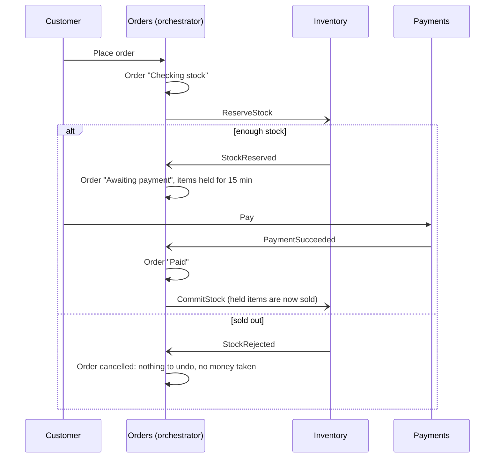

# Events and the checkout saga

Services talk to each other through Kafka for anything that changes state in more than one service. Direct HTTP calls remain only for reads that need an answer straight away. For example, payments asks orders for an order's total before taking a payment.

## Message format

Every message is a JSON object with the same envelope:

```json
{
  "id": "5f0c1c5e-0d6f-4c39-9a51-2b8f5b0a8e41",
  "type": "ReserveStock",
  "source": "orders",
  "occurred_at": "2026-11-12T10:21:07.412Z",
  "key": "SV-20261112-K7Q2ZP",
  "data": { "order_number": "SV-20261112-K7Q2ZP", "lines": [{ "variant_id": "…", "quantity": 2 }] }
}
```

- **`id`** is unique per message. Consumers that keep a database record every id they've handled, so a message delivered twice is handled once. The search service relies on revisions instead (see [Catalogue events for search](#catalogue-events-for-search)).
- **`key`** is also the Kafka message key. All messages about one order use the order number, so they land on the same partition and are read in the order they were sent. Variant messages use the variant id, and product messages use the product id.

## Topics

| Topic | Written by | Read by | Messages |
|---|---|---|---|
| `catalog.variants` | products | inventory | `VariantUpserted`, `VariantRemoved` |
| `catalog.products` | products | search | `ProductUpserted`, `ProductRemoved` |
| `inventory.commands` | orders | inventory | `ReserveStock`, `ReleaseStock`, `CommitStock` |
| `inventory.events` | inventory | orders | `StockReserved`, `StockRejected`, `StockReleased`, `StockCommitted` |
| `payments.commands` | orders | payments | `RefundPayment` |
| `payments.events` | payments | orders, notifications | `PaymentSucceeded`, `PaymentFailed`, `PaymentRefunded`, `RefundFailed` |
| `orders.events` | orders | notifications, analytics (Spark) | `OrderPlaced`, `OrderConfirmed`, `OrderCancelled` |
| `clickstream.events` | clickstream collector | analytics (Spark) | `product_view`, `search`, `add_to_cart` (see below) |
| `clickstream.events.dlq` | analytics (Spark) | nobody yet; check by hand | Messages that couldn't be read as a storefront event |
| `users.events` | users | products, notifications | `SellerStatusChanged`, `UserRegistered`, `UserContactChanged` |

Every topic has a dead-letter twin (`<topic>.dlq`). A message that still fails after 3 attempts is moved there with the error attached, so one bad message can't block everything behind it.

## Catalogue events for search

`catalog.products` carries the whole product, not just what changed. A `ProductUpserted` message holds the product's name, brand, category path, images, variants, colours, sizes and price range, plus a **revision**: a counter the products service bumps every time it announces the product. The search service writes each message to Elasticsearch with the revision as the document version, so a write with an older or equal revision is refused. Duplicates and out-of-date messages change nothing, and the service keeps no table of message ids.

A product that is drafted, or has no active option, is sent as `ProductUpserted` with `listed: false`, not as a removal. That way the search service keeps its revision, and an older listed message can't bring the product back. `ProductRemoved` is sent only when the product is deleted.

## Seller approvals: users to products

The users service owns seller accounts. When a seller registers, and whenever an admin approves, suspends or reinstates one, it writes a `SellerStatusChanged` message in the same transaction as the change:

```json
{ "seller_id": "00000000-0000-4000-8000-000000000001", "status": "approved" }
```

`status` is `pending`, `approved` or `suspended`. The key is the seller id, so one seller's changes are read in the order they happened.

The products service keeps a copy of each status and refuses a seller's writes (creating, editing, archiving products, variants and images) unless the status is `approved`. A seller with no status yet is refused as well, so an unapproved seller can't write before products has heard about them. Reads are not blocked, so a suspended seller can still see their own products. An unknown status value is retried and then dead-lettered, not guessed.

When the users service was first given approval, its migration wrote a `SellerStatusChanged` message for each existing seller, so the products service knew about them straight away.

## Customer contact and emails: users and orders to notifications

The users service announces a customer's contact details when they change, so the notifications service can email them without calling users:

- `UserRegistered`, when an account is created (signup, an admin, the seed command). A backfill migration sent one for every existing user.
- `UserContactChanged`, when the first name, last name or email changes, through the profile or in admin.

```json
{ "user_id": "…", "email": "nia@example.com", "first_name": "Nia", "last_name": "Khan" }
```

The key is the user id. A save that changes none of these fields announces nothing.

`OrderPlaced` and `OrderConfirmed` carry the item lines the emails show, in `items`: each has `product_id`, `name`, `colour`, `size`, `quantity`, `unit_price` and `line_total`. The product id is there for analytics, which counts purchases per product. No event carries the delivery address. The order page shows it.

The notifications service (`services/notifications`) reads `orders.events`, `payments.events` and `users.events`. It keeps its own copy of each customer's name and email, and sends an email for:

- `OrderPlaced`, `OrderConfirmed` and `OrderCancelled` (orders.events);
- `PaymentFailed` and `PaymentRefunded` (payments.events).

Payment and cancellation events carry only the order number, so the service keeps a map from each order number to its customer, recorded from `OrderPlaced`. The topics are read independently, so a customer's first order can arrive before their contact details. Such a message waits up to two minutes, then goes to the dead-letter topic.

An email is sent inside the message's transaction. If the service crashes after the email leaves but before the commit, the message is read again and the customer may get the email twice. That is accepted: a lost order confirmation is worse than a duplicate.

## Storefront events: clickstream to Spark

The storefront records three events: `product_view` (with `source` of `search`, `category` or `direct`), `search` (the query and how many results it gave), and `add_to_cart`. It sends them in batches of up to 100 to `POST /api/v1/clickstream/events` through the gateway. The collector (`services/clickstream`) checks each event against its schema and queues it on `clickstream.events`, keyed by the anonymous session id.

These messages don't use the envelope above, and they don't go through the outbox. Each event is the event itself, with two fields added: `user_id` (from the signed-in shopper's token, or `null`) and `received_at`. The request is answered `202` once the event is queued, not once Kafka has stored it. Analytics can lose a few events if a broker or the collector fails at the wrong moment. An order confirmation can't be lost, which is why orders use the outbox.

Every event has an `event_id`. A batch sent again is counted once, which lets the storefront retry after a network failure. A `503` means the collector's queue was full, and the same batch should be sent again.

The Spark job (`analytics/clickstream`) reads `clickstream.events` and `orders.events`, drops repeats by `event_id`, and writes:

- `raw_events`: every accepted event, as Parquet, partitioned by date and hour;
- `product_totals`: per product and five-minute window, the views, add-to-carts and units sold (`OrderConfirmed` items);
- `search_terms`: how often each search term was run in each window.

A message the job can't read goes to `clickstream.events.dlq` with its original text, so nothing is dropped silently.

## How a message gets out: the transactional outbox

A service never writes to its database and then sends to Kafka as two separate steps. If it crashed between them, the database and the rest of the system would disagree. Instead, the message is written to an `outbox` table **in the same database transaction** as the change it describes. A relay in the service's worker reads unsent rows, publishes them, and marks them sent.

- If the transaction rolls back, no message exists.
- If the relay crashes after publishing but before marking a row sent, that message goes out twice. Consumers drop the duplicate by its id.

## How a message is handled: idempotent consumers

Each worker reads with automatic offset commits switched off. For every message it:

1. records the message id in `processed_messages` (a repeat stops here),
2. runs the handler,
3. writes any reply to its own outbox,

all in one database transaction. Only after that commit does it commit the Kafka offset. A crash at any point means the message is read again and either handled in full or recognised as already done.

If the database is unreachable, the worker waits and retries the same message without skipping it. Any other error is retried 3 times and then sent to the dead-letter topic.

## The checkout saga

Placing an order touches three services, each with its own database, so there's no single transaction that can cover them. The orders service runs the checkout as a **saga**: a series of local steps, each with an undo step (a *compensation*) if a later step fails. Orders is the **orchestrator**. It keeps the saga's state next to the order, sends commands, reacts to the replies, and decides what to undo.



### What gets undone, and when

| What happens | Order becomes | Compensation sent |
|---|---|---|
| Stock can't be reserved | Cancelled ("sold out") | None (nothing was held or charged) |
| No answer from inventory within 2 minutes | Cancelled | `ReleaseStock`, in case the reservation lands later |
| Not paid within the hold time (15 minutes) | Cancelled | `ReleaseStock` |
| Customer or admin cancels before payment | Cancelled | `ReleaseStock` |
| Customer or admin cancels after payment | Cancelled | `ReleaseStock` (back on sale) and `RefundPayment` |
| Payment arrives after the order was cancelled | Stays cancelled | `RefundPayment` |
| Payment amount doesn't match the order | Stays awaiting payment | `RefundPayment`; the customer can pay again |

Timeouts are checked by the orders worker every few seconds. Every step locks the order row, so a payment arriving at the same moment the hold expires is handled one way or the other, never both. If the timeout wins, the late payment is refunded.

### Why stock is held, then committed

A reservation (`reserved += n`) takes items off sale without changing what's on the shelf. Only when the order is paid does `CommitStock` turn the hold into a sale (`on_hand -= n`, `reserved -= n`). Releasing a hold just gives the items back. Releasing after a sale (a paid order cancelled before shipping) puts them back on the shelf.

The inventory service locks every stock row it touches, in a fixed order, before checking availability. Two checkouts racing for the last item can't both get it, and two checkouts locking the same items can't deadlock.
