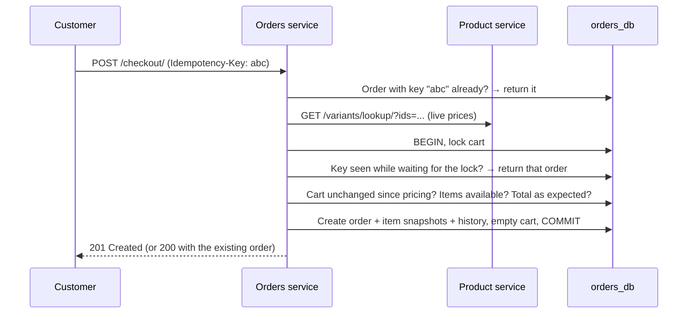
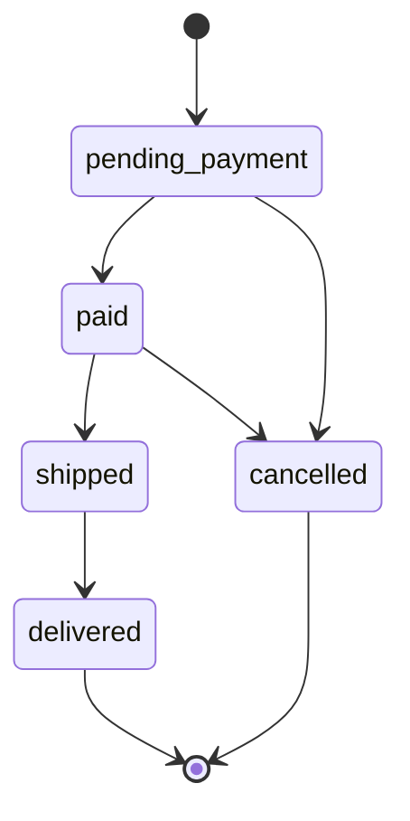

# Orders service

Carts, checkout and the order lifecycle for Shopverse.

**Stack:** Django 5.1, Django REST Framework, httpx, PostgreSQL (`orders_db`)

## How checkout works



- **Prices come from the product service, never the client.** The cart only stores variant ids and quantities.
- **No lock is held during the network call.** Prices are fetched first; then the cart is locked and checked against what was priced. If it changed in between, checkout returns `409 cart_changed`.
- **Idempotency:** send an `Idempotency-Key` header (e.g. a UUID generated when the checkout page loads). Repeating the request, even several at the same moment, returns the same order. A database constraint guarantees one order per key per user.
- **Price protection:** send the `expected_total` the customer saw; if prices changed, checkout returns `409 price_changed` instead of charging a different amount.
- **Coupons are checked under the same lock.** The code is read and locked with the cart, so its usage count can't change mid-checkout. A code that has expired or run out returns `409 coupon_invalid`, and no order is created.
- **Flash sale caps are checked under a lock too.** A capped sale item is locked for the checkout, then its units sold across live orders are counted. Asking for more than is left returns `409 flash_sale_sold_out` with `remaining`. Cancelled orders give their units back.
- **Snapshots:** each order copies product names, SKUs, prices, the seller and the shipping address, so later catalogue or address changes never rewrite an old order.

Stock is not reserved yet; that arrives with the inventory service.

## Order lifecycle



Any other move is rejected with `409`. Every change is recorded in the order's history with who made it and an optional note. Customers can cancel while an order is `pending_payment` or `paid`. The [payments service](../payments/README.md) marks orders as `paid`; admins move them along after that.

## API

Base path: `/api/v1/`. Every endpoint needs a JWT from the users service.

### Cart

| Method | Endpoint | Description |
|---|---|---|
| GET | `cart/` | Cart with live prices, the applied coupon (with the reason if it's no longer valid), discount, shipping and total |
| DELETE | `cart/` | Empty the cart |
| POST | `cart/items/` | Add `{variant_id, quantity}`; adding again increases the quantity |
| PATCH | `cart/items/{variant_id}/` | Set the quantity |
| DELETE | `cart/items/{variant_id}/` | Remove a line |
| PUT | `cart/coupon/` | Apply a coupon code: `{code}`. Refused with `400` and a `code` saying why, such as `coupon_expired` or `coupon_min_not_met` |
| DELETE | `cart/coupon/` | Remove the applied code |
| GET | `flash-sales/sold/?items=<id>,<id>` | Units sold so far for flash sale items, counted from live orders. Public; gives counts only, never buyers |

Items that stop being available are listed in `unavailable_variant_ids` and left out of the totals. If the product service is down, the cart still loads, with `prices_available: false`.

### Checkout and orders

| Method | Endpoint | Description |
|---|---|---|
| POST | `checkout/` | Place an order from the cart (see below) |
| GET | `orders/` | Your orders, newest first |
| GET | `orders/{number}/` | One of your orders, with items and history |
| POST | `orders/{number}/cancel/` | Cancel, with an optional `reason` |

```bash
curl -H "Authorization: Bearer <token>" -H "Content-Type: application/json" \
  -H "Idempotency-Key: 7f6c0a52-4b7e-4c55-9b51-0c1d2f6a1e11" \
  -d '{
        "shipping_address": {"full_name": "Alice Smith", "phone": "07700900123",
                             "line1": "1 High Street", "city": "London", "postcode": "E1 6AN"},
        "expected_total": "59.98"
      }' \
  http://localhost:8003/api/v1/checkout/
```

Checkout errors carry a `code`:

| Status | Code | Meaning |
|---|---|---|
| 400 | `cart_empty` | Nothing to order |
| 409 | `items_unavailable` | Some items can't be bought any more (`unavailable_variant_ids`) |
| 409 | `price_changed` | Real total differs from `expected_total` |
| 409 | `cart_changed` | Cart changed during checkout; retry |
| 409 | `coupon_invalid` | The applied code can't be used any more (`reason` says why). The cart keeps the code so the customer can see it |
| 409 | `flash_sale_sold_out` | Fewer units are left at the sale price than the quantity in the basket (`remaining` says how many, `variant_id` says which item) |
| 503 | `catalog_unavailable` | Product service unreachable; the cart is kept |

### Sellers

| Method | Endpoint | Description |
|---|---|---|
| GET | `seller/sales/` | Your own lines across all orders (`?status=` to filter). Other sellers' items and buyer details are hidden. |
| GET | `seller/summary/` | Dashboard numbers: sales total, units sold, orders, products sold, lines waiting to ship, and units sold per day for the last 7 days. Only paid, shipped and delivered orders count. Revenue is the value of the seller's lines before any platform coupon, so coupons don't change what sellers earn. |

### Admins

| Method | Endpoint | Description |
|---|---|---|
| GET | `admin/orders/` | All orders (`?status=` to filter) |
| GET | `admin/orders/summary/` | Number of orders in each status |
| GET | `admin/orders/{number}/` | Any order |
| POST | `admin/orders/{number}/transition/` | `{status, note}` to move an order along |
| GET, POST | `admin/coupons/` | List coupons with `used_count`, or create one: `code`, `kind` (`percent` or `fixed`), `value`, `min_subtotal`, `starts_at`, `ends_at`, `usage_limit`, `per_customer_limit`, `is_active` |
| GET, PATCH | `admin/coupons/{code}/` | One coupon. Everything can change except the code; switch a code off with `is_active: false` |

### Internal (role `service`)

| Method | Endpoint | Description |
|---|---|---|
| POST | `internal/orders/{number}/payment-confirmed/` | Called by the payments service: `{payment_id, amount, currency}`. Marks a `pending_payment` order as `paid`. Safe to repeat. Returns `409 amount_mismatch` if the amount or currency doesn't match the order, and `409 order_cancelled` if the order was cancelled first. |

Customers can't get the `service` role, so they can't call this.

## Rules enforced

- Up to 10 of one item and 50 lines per cart (configurable).
- Shipping is £4.99, free from £50 (configurable). All money uses `Decimal`, rounded to pennies.
- The database checks that `total = subtotal - discount_amount + shipping_fee` and `line_total = unit_price × quantity`.
- Coupons are created by admins only. A percentage is 1 to 100, a fixed amount is more than zero, and a minimum basket is checked before the discount. A code can have a start and end date, a total use limit and a per-customer limit. A use is an order that carries the code and hasn't been cancelled, so cancelling an order gives its use back.
- Shipping is judged on the subtotal before the discount, so a coupon never adds a shipping fee.
- Order numbers look like `SV-20261029-K7Q2ZP`: readable, random and unique.
- Customers only ever see their own carts and orders; another customer's order number returns 404.

## Running

```bash
docker compose up -d orders     # also starts Postgres and the product service
```

The API is on http://localhost:8003.

## Tests

```bash
docker compose run --rm orders pytest
```

146 tests, run against PostgreSQL with a fake product service: cart behaviour and limits, coupons (discount maths, every refusal, usage limits, cancelled orders freeing a use, admin rules), flash sale prices and caps (sold-out refusals, units counted from live orders, cancelled orders freeing units, the sold count endpoint), server-side pricing, shipping, every checkout error, idempotency (including a duplicate that waits on the lock), cart changes mid-checkout, price protection, snapshots, every legal and illegal status change, ownership, seller privacy, the seller and admin summaries, payment confirmation from the payments service, database constraints and HTTP failures when calling the product service.

## Configuration

| Variable | Default | Description |
|---|---|---|
| `DJANGO_SECRET_KEY` | required | |
| `JWT_SIGNING_KEY` | required | Same value as the users service |
| `DB_NAME`, `DB_USER`, `DB_PASSWORD`, `DB_HOST`, `DB_PORT` | `orders_db`, required, required, `localhost`, `5432` | |
| `PRODUCTS_SERVICE_URL` | `http://localhost:8002` | `http://products:8000` inside Compose |
| `PRODUCTS_SERVICE_TIMEOUT` | `3` | Seconds |
| `CURRENCY` | `GBP` | |
| `MAX_QUANTITY_PER_ITEM` | `10` | |
| `MAX_CART_ITEMS` | `50` | |
| `SHIPPING_FEE` | `4.99` | |
| `FREE_SHIPPING_THRESHOLD` | `50.00` | |
