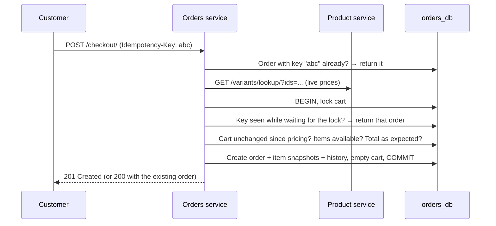
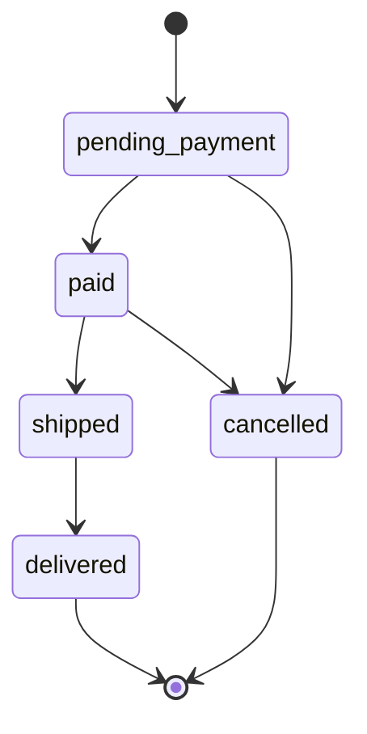

# Orders service

Carts, checkout and the order lifecycle for Shopverse.

**Stack:** Django 5.1, Django REST Framework, httpx, PostgreSQL (`orders_db`)

## How checkout works



- **Prices come from the product service, never the client.** The cart only stores variant ids and quantities.
- **No lock is held during the network call.** Prices are fetched first; then the cart is locked and checked against what was priced. If it changed in between, checkout returns `409 cart_changed`.
- **Idempotency:** send an `Idempotency-Key` header (e.g. a UUID generated when the checkout page loads). Repeating the request, even several at the same moment, returns the same order. A database constraint guarantees one order per key per user.
- **Price protection:** send the `expected_total` the customer saw; if prices changed, checkout returns `409 price_changed` instead of charging a different amount.
- **Snapshots:** each order copies product names, SKUs, prices, the seller and the shipping address, so later catalogue or address changes never rewrite an old order.

Stock is not reserved yet; that arrives with the inventory service.

## Order lifecycle



Any other move is rejected with `409`. Every change is recorded in the order's history with who made it and an optional note. Customers can cancel while an order is `pending_payment` or `paid`. The [payments service](../payments/README.md) marks orders as `paid`; admins move them along after that.

## API

Base path: `/api/v1/`. Every endpoint needs a JWT from the users service.

### Cart

| Method | Endpoint | Description |
|---|---|---|
| GET | `cart/` | Cart with live prices, subtotal, shipping and total |
| DELETE | `cart/` | Empty the cart |
| POST | `cart/items/` | Add `{variant_id, quantity}`; adding again increases the quantity |
| PATCH | `cart/items/{variant_id}/` | Set the quantity |
| DELETE | `cart/items/{variant_id}/` | Remove a line |

Items that stop being available are listed in `unavailable_variant_ids` and left out of the totals. If the product service is down, the cart still loads, with `prices_available: false`.

### Checkout and orders

| Method | Endpoint | Description |
|---|---|---|
| POST | `checkout/` | Place an order from the cart (see below) |
| GET | `orders/` | Your orders, newest first |
| GET | `orders/{number}/` | One of your orders, with items and history |
| POST | `orders/{number}/cancel/` | Cancel, with an optional `reason` |

```bash
curl -H "Authorization: Bearer <token>" -H "Content-Type: application/json" \
  -H "Idempotency-Key: 7f6c0a52-4b7e-4c55-9b51-0c1d2f6a1e11" \
  -d '{
        "shipping_address": {"full_name": "Alice Smith", "phone": "07700900123",
                             "line1": "1 High Street", "city": "London", "postcode": "E1 6AN"},
        "expected_total": "59.98"
      }' \
  http://localhost:8003/api/v1/checkout/
```

Checkout errors carry a `code`:

| Status | Code | Meaning |
|---|---|---|
| 400 | `cart_empty` | Nothing to order |
| 409 | `items_unavailable` | Some items can't be bought any more (`unavailable_variant_ids`) |
| 409 | `price_changed` | Real total differs from `expected_total` |
| 409 | `cart_changed` | Cart changed during checkout; retry |
| 503 | `catalog_unavailable` | Product service unreachable; the cart is kept |

### Sellers

| Method | Endpoint | Description |
|---|---|---|
| GET | `seller/sales/` | Your own lines across all orders (`?status=` to filter). Other sellers' items and buyer details are hidden. |

### Admins

| Method | Endpoint | Description |
|---|---|---|
| GET | `admin/orders/` | All orders (`?status=` to filter) |
| GET | `admin/orders/{number}/` | Any order |
| POST | `admin/orders/{number}/transition/` | `{status, note}` to move an order along |

### Internal (role `service`)

| Method | Endpoint | Description |
|---|---|---|
| POST | `internal/orders/{number}/payment-confirmed/` | Called by the payments service: `{payment_id, amount, currency}`. Marks a `pending_payment` order as `paid`. Safe to repeat. Returns `409 amount_mismatch` if the amount or currency doesn't match the order, and `409 order_cancelled` if the order was cancelled first. |

Customers can't get the `service` role, so they can't call this.

## Rules enforced

- Up to 10 of one item and 50 lines per cart (configurable).
- Shipping is £4.99, free from £50 (configurable). All money uses `Decimal`, rounded to pennies.
- The database checks that `total = subtotal + shipping_fee` and `line_total = unit_price × quantity`.
- Order numbers look like `SV-20261029-K7Q2ZP`: readable, random and unique.
- Customers only ever see their own carts and orders; another customer's order number returns 404.

## Running

```bash
docker compose up -d orders     # also starts Postgres and the product service
```

The API is on http://localhost:8003.

## Tests

```bash
docker compose run --rm orders pytest
```

68 tests, run against PostgreSQL with a fake product service: cart behaviour and limits, server-side pricing, shipping, every checkout error, idempotency (including a duplicate that waits on the lock), cart changes mid-checkout, price protection, snapshots, every legal and illegal status change, ownership, seller privacy, payment confirmation from the payments service, database constraints and HTTP failures when calling the product service.

## Configuration

| Variable | Default | Description |
|---|---|---|
| `DJANGO_SECRET_KEY` | required | |
| `JWT_SIGNING_KEY` | required | Same value as the users service |
| `DB_NAME`, `DB_USER`, `DB_PASSWORD`, `DB_HOST`, `DB_PORT` | `orders_db`, required, required, `localhost`, `5432` | |
| `PRODUCTS_SERVICE_URL` | `http://localhost:8002` | `http://products:8000` inside Compose |
| `PRODUCTS_SERVICE_TIMEOUT` | `3` | Seconds |
| `CURRENCY` | `GBP` | |
| `MAX_QUANTITY_PER_ITEM` | `10` | |
| `MAX_CART_ITEMS` | `50` | |
| `SHIPPING_FEE` | `4.99` | |
| `FREE_SHIPPING_THRESHOLD` | `50.00` | |
