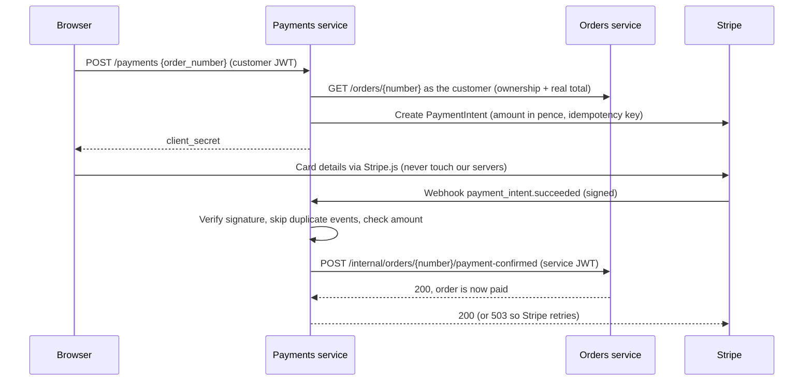

# Payments service

Takes payment for orders through **Stripe in test mode**, or through a **fake provider** that needs no Stripe account, for local development and demos. When a payment succeeds, it tells the orders service, which marks the order as paid.

**Stack:** FastAPI, SQLAlchemy 2, Alembic, PostgreSQL (`payments_db`), Stripe Python SDK, PyJWT, httpx

Interactive API docs (Swagger) are at http://localhost:8004/docs.

## How a payment works



## Security and reliability

- **Card details never reach Shopverse.** The browser sends them straight to Stripe; this service only ever sees a payment id.
- **The amount comes from the orders service,** not the browser. It's stored in pence, like Stripe expects.
- **Webhooks are verified** with Stripe's HMAC signature. Forged, tampered or replayed (older than 5 minutes) events are rejected with `400`.
- **Duplicate webhooks are harmless.** Stripe delivers events at least once, so every event id is stored in `processed_events` with a primary key; the second delivery is a no-op.
- **If the orders service is down,** the webhook answers `503` and nothing is saved, so Stripe retries later (for up to 3 days). Confirming an order is safe to repeat.
- **Amounts are checked twice:** here against the stored payment, and again by the orders service against the order total. A mismatch never marks an order paid; the payment is flagged `amount_mismatch` for a human.
- **Ownership:** payments are tied to the customer who started them; someone else's order or payment returns 404.
- **Live keys are refused.** The service won't start with a Stripe key that doesn't start with `sk_test_`.
- **Service-to-service calls** to the orders service use a 60-second JWT with role `service`. Customers can't get that role, so they can't call the internal endpoint.

## Payment statuses

| Status | Meaning |
|---|---|
| `requires_payment` | Created, waiting for the customer |
| `succeeded` | Paid, and the order has been marked paid |
| `failed` | Last attempt failed (e.g. card declined). Starting the payment again retries it. |
| `refund_required` | Money was taken but the order had been cancelled in the meantime |
| `amount_mismatch` | Stripe's amount didn't match; needs investigation |

Refunds are not automated yet; `refund_required` payments are listed for manual handling.

## API

Base path: `/api/v1/`. All endpoints except the webhook need a customer JWT.

| Method | Endpoint | Description |
|---|---|---|
| POST | `payments` | Start paying for one of your orders: `{"order_number": "..."}`. Returns the `client_secret` for Stripe.js. Calling it again returns the same payment. |
| GET | `payments/{order_number}` | Payment status (no client secret) |
| POST | `payments/{order_number}/simulate` | **Fake provider only:** `{"outcome": "succeeded" \| "failed"}`, as if the webhook had arrived |
| POST | `webhooks/stripe` | **Stripe provider only:** receives signed Stripe events |
| GET | `/health` | Health check |

Errors look like `{"detail": {"code": "...", "detail": "..."}}`. Codes: `order_not_found` (404), `not_payable` and `already_paid` (409), `orders_unavailable` (503), `provider_error` (502).

## Try it without Stripe

With `PAYMENT_PROVIDER=fake` (the default):

```bash
# 1. Start paying for an order you placed with the orders service
curl -H "Authorization: Bearer <token>" -H "Content-Type: application/json" \
  -d '{"order_number": "SV-20261029-K7Q2ZP"}' http://localhost:8004/api/v1/payments

# 2. Pretend the card was accepted
curl -H "Authorization: Bearer <token>" -H "Content-Type: application/json" \
  -d '{"outcome": "succeeded"}' http://localhost:8004/api/v1/payments/SV-20261029-K7Q2ZP/simulate

# 3. The order is now paid
curl -H "Authorization: Bearer <token>" http://localhost:8003/api/v1/orders/SV-20261029-K7Q2ZP/
```

## Using real Stripe test mode

1. Create a free Stripe account and copy the **test** secret key from https://dashboard.stripe.com/test/apikeys.
2. Install the Stripe CLI and forward webhooks to the service:
   ```bash
   stripe listen --forward-to localhost:8004/api/v1/webhooks/stripe
   ```
   It prints a webhook signing secret (`whsec_...`).
3. In `.env`:
   ```
   PAYMENT_PROVIDER=stripe
   STRIPE_SECRET_KEY=sk_test_...
   STRIPE_WEBHOOK_SECRET=whsec_...
   ```
4. Restart: `docker compose up -d payments`. Pay with Stripe's test card `4242 4242 4242 4242` (any future date, any CVC), or trigger events with `stripe trigger payment_intent.succeeded`.

## Database migrations

Schema changes are managed with Alembic and applied automatically on start.

```bash
docker compose exec payments alembic upgrade head     # apply
docker compose exec payments alembic check            # models and migrations in sync?
docker compose exec payments alembic revision --autogenerate -m "describe change"
```

## Tests

```bash
docker compose run --rm payments pytest
```

46 tests. They build their own `payments_test` database with the real migrations and never touch `payments_db`. Webhook tests sign events with real HMAC signatures and run them through Stripe's own verification code. Covered: token checks (forged, expired, wrong type, `alg: none`), ownership, amounts from the server, retries after a declined card, duplicate and out-of-order events, forged, tampered and replayed webhooks, amount mismatches, orders service outages, cancelled-meanwhile refunds, and configuration safety checks.

## Configuration

| Variable | Default | Description |
|---|---|---|
| `JWT_SIGNING_KEY` | required | Same value as the users service; at least 32 characters |
| `DB_NAME`, `DB_USER`, `DB_PASSWORD`, `DB_HOST`, `DB_PORT` | `payments_db`, required, required, `localhost`, `5432` | |
| `PAYMENT_PROVIDER` | `fake` | `fake` or `stripe` |
| `STRIPE_SECRET_KEY` | | Test key, `sk_test_...` |
| `STRIPE_WEBHOOK_SECRET` | | `whsec_...` |
| `ORDERS_SERVICE_URL` | `http://localhost:8003` | `http://orders:8000` inside Compose |
| `ORDERS_SERVICE_TIMEOUT` | `5` | Seconds |
| `DEBUG` | `false` | |
